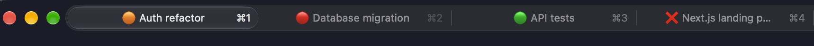

# Claude Code tabs status for Ghosty terminal



plugin that shows agent's status in the Ghostty terminal tab title.

🟠 working · 🔴 waiting for you · 🟢 done · ❌ error

Each tab gets a short name generated from your first prompt (or your `/rename` name). Uses Claude Code hooks only, so Ghostty updates can't break it. Works in any terminal that shows the window title in its tabs.

## Install

In Claude Code:

```
/plugin marketplace add nicknotknack/claude-tab-status-for-ghosty
/plugin install ghostty-tab-status@nicknotknack
```

In your terminal (stops Claude Code from overwriting the tab title):

```sh
f=~/.claude/settings.json; jq '.env.CLAUDE_CODE_DISABLE_TERMINAL_TITLE="1"' "$f" > "$f.tmp" && mv "$f.tmp" "$f"
```

Restart `claude`.

## Uninstall

```
/plugin uninstall ghostty-tab-status@nicknotknack
```

```sh
f=~/.claude/settings.json; jq 'del(.env.CLAUDE_CODE_DISABLE_TERMINAL_TITLE)' "$f" > "$f.tmp" && mv "$f.tmp" "$f"
```
